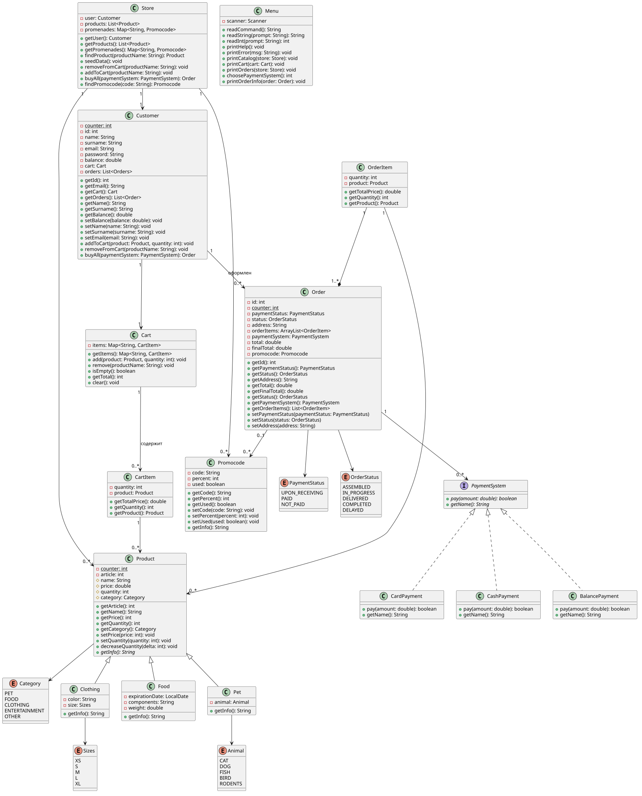

# Internet Store

## О проекте
Привет! Это простая эмуляция системы интернет - магазина,
которая была создана в процессе выполнения лабораторной работы.

### Реализованы:
- [x] Разные типы товаров (наследуются от Product): Pet (Зоо-товары), Food (Продукты питания), Clothing (Одежда)
- [x] Работа с корзиной
- [x] Разные системы оплаты
- [x] Работа с заказами
- [x] Консольный ввод команд и вывод результатов
- [x] Обработка ошибок (try - catch)

*Планируется добавить возможность применения промокодов.*

## UML-диаграмма
Для понимания как работает данная система, 
была нарисована диаграмма классов на языке PlantUML.

## Диаграмма последовательностей
Планируется добавить в следующем обновлении.